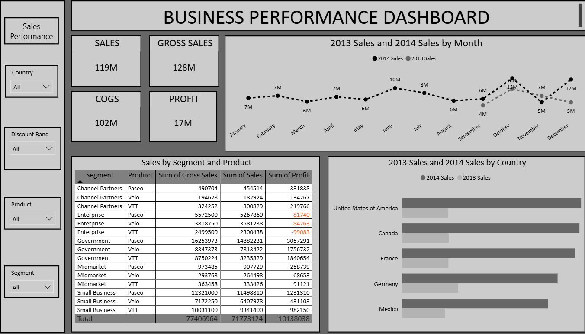

# Business Performance Dashboard

**Sales, Profit, and Discount Analysis in Power BI** | Power BI, Power Query, DAX, Excel

I built an interactive Power BI dashboard and a case study on 700 sales records (Sep 2013 to Dec 2014) that track sales, gross sales, COGS, and profit across 5 countries, 6 products, and 5 segments, and show where discounts reduce margin.

**Objective:** To track sales and profit across countries, products, and segments, and to find where discounts reduce margin.

## Dashboard Preview



Full case study (15 pages): [Business_Performance_Case_Study.pdf](report/Business_Performance_Case_Study.pdf)

## Business Questions

1. How are sales, gross sales, COGS, and profit performing across countries, products, and segments?
2. Which segments drive sales and profit, and which lose money?
3. How do discounts affect margin?
4. How do the same months compare year-on-year (Sep-Dec 2013 vs 2014), and can the data be trusted?

## Dataset

Public Financial Sample dataset from the Data Science Tutorials channel: 700 sales records from Sep 2013 to Dec 2014, across 5 countries, 6 products, and 5 segments. The raw data is not included in this repository. Fields used include sales, gross sales, COGS, profit, units, manufacturing price, discount band, segment, product, country, and date. Amounts are in dollars.

## Approach

1. **Clean:** in Power Query, fix data types, fix a hidden space in a column name, and build a date table.
2. **Model:** a star schema with one sales table and date, product, segment, and country lookups.
3. **Measure:** DAX measures for sales, profit, margin, and like-for-like year-on-year.
4. **Build:** the dashboard with KPI cards, a monthly trend (2013 vs 2014), a country comparison, and a segment and product breakdown, with filters for country, discount band, product, and segment.
5. **Validate:** reconcile sales, discount, and profit totals to the Excel source on all 700 rows.
6. **Read:** the results, then write findings, data checks, and recommendations in a case study.

## Key Findings

* Total sales are $118.7M with $16.9M profit, a margin of about 14%.
* Government accounts for 44% of sales and 67% of profit.
* Enterprise sells $19.6M but loses $0.61M. 58 of 100 Enterprise orders made a loss, and every Enterprise order discounted 5% or more lost money.
* High discounts (10-15%) are 31% of sales but keep only a 9.1% margin, against 21.9% with no discount.
* Comparing the same four months (Sep-Dec), sales grew 37% and profit grew 40%.

## Recommendations

* Cap Enterprise discounts at 4%, since every Enterprise order discounted 5% or more lost money.
* Add an approval step for discounts of 10% and above.
* Check why June, October, and December 2014 have twice as many records before reading them as peaks.

## Limits

* 2013 covers Sep-Dec only, so year-on-year compares the same four months.
* June, October, and December 2014 have twice as many records as other months, so those peaks reflect record counts, not demand.
* Units multiplied by manufacturing price do not match COGS in 536 of 700 rows.
* It is a public sample dataset of 700 records, so the findings describe this data only.

## Tools and Skills

**Tools:** Power BI, Power Query, DAX (sales, profit, margin, and like-for-like year-on-year measures), Excel

**Skills:** Data Analysis, Data Visualization, Dashboard Design, Data Modeling, Data Cleaning, Data Validation

## Repository Structure

```
business-performance-dashboard/
├── README.md
├── dashboard/   (dashboard image)
└── report/      (case study PDF)
```

## Author

Umair Khalil | Senior Data Analyst

## Disclaimer

Independent portfolio project, built following a Data Science Tutorials walkthrough. Not affiliated with Data Science Tutorials. Data: Financial Sample dataset from the Data Science Tutorials channel. Dataset credit to Data Science Tutorials. All figures come from the Power BI dashboard and the case study (700 records, Sep 2013 to Dec 2014). Amounts are in dollars.
